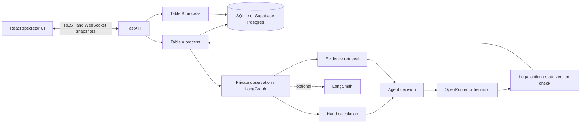

# Skeleton architecture

## Invariants

1. PokerKit owns all card, betting and settlement state. The UI renders snapshots and sends session controls only.
2. One worker process owns a table. Cross-table resources are read-only code, API configuration and persistence, never opponent beliefs or hand state. There is no central decision scheduler.
3. Spectator snapshots and agent observations are different schemas. The agent never receives other hole cards, future deck cards, scripted profiles or future results.
4. All committed snapshots have a monotonically increasing version. Decision versions must match before actions are applied.
5. Engine advancement is sequential within one table. Model work cannot mutate engine state. Commands are applied at action boundaries.
6. All model outputs are untrusted. Only a legal menu action and supplied evidence IDs are accepted. Unknown provider output never becomes authoritative strategy data.
7. ICM is a descriptive tool until explicitly integrated into a validated decision evaluator. Random-range equity is never labeled inferred-range equity or solver EV.
8. API keys and database passwords never enter React, event snapshots or prompts.

## Current policy seam

`Agent.decide(observation)` returns a validated action and an auditable decision record. The observation contains the complete current-hand betting sequence and bounded per-opponent evidence. Replace or expand graph nodes while preserving this boundary.

The current discrete action menu offers check/call/fold and several legal raise-to sizes. It is an abstraction for the agent, not an unrestricted NLH solver. The engine enforces real minimum raises, all-in exceptions and pot settlement.

## Next strategy experiments

The target is an LLM-led poker agent with callable tools for evidence, calculations, strategy references and competing hypotheses. Strategy analysis runs inside the backend; the LLM owns final poker decisions, subject to legal-action and state-version enforcement. See [poker agent direction](agent-direction.md) for the clarified design and the distinction from current functionality.

1. Define and test opponent range priors and action-likelihood updates.
2. Add ICM-aware all-in response calculations with explicit equity/range uncertainty and pot eligibility.
3. Add bounded parallel hypotheses, future-street scenarios and a defensive critique.
4. Compare full agent against identical model without memory/search across held-out opponent configurations and seat rotations.
5. Track prediction calibration, decision quality, tournament prize outcomes, latency and cost. One winning tournament is not evidence of professional-level play.

## Persistence and deployment

Snapshots are authoritative replay artifacts in this skeleton, not executable engine checkpoints. The service marks unfinished sessions interrupted on restart. Production resume, retention, migrations and multi-user Supabase Auth remain separate work.

The process boundary isolates CPU/model latency between tables, but both still share host capacity and provider account limits. Keep per-table budgets bounded. The current implementation starts at most two workers.
